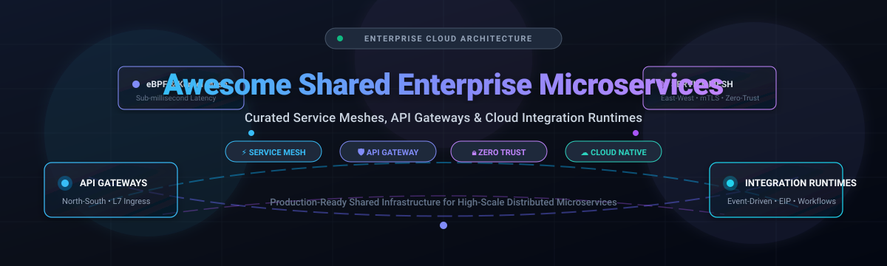

# 🚀 Awesome Shared Enterprise Microservices

  
  
  
  
  

> 🌟 A curated list of top Shared Enterprise Microservices platforms — both SaaS/Hosted commercial solutions and open-source alternatives for service mesh, API gateways, integration runtimes, and distributed application runtimes that power shared infrastructure for microservices architectures.  
> ⭐ **Star this repo if you find it useful!** ⭐

---

## 📋 Table of Contents

- [📈 Sector Overview & Market Dynamics](#-sector-overview--market-dynamics)
- [🟦 SaaS / Hosted Platforms](#-saas--hosted-platforms)
- [🟩 Open-Source Software](#-open-source-software)
  - [⚡ Traefik](#traefik)
  - [🛡️ Kong Gateway](#kong-gateway)
  - [🕸️ Istio](#istio)
  - [🌐 HashiCorp Consul](#hashicorp-consul)
  - [🏎️ Envoy Proxy](#envoy-proxy)
  - [🧩 Dapr](#dapr)
  - [🐝 Cilium Service Mesh](#cilium-service-mesh)
  - [🔀 Apache APISIX](#apache-apisix)
  - [🔗 Linkerd](#linkerd)
  - [⛩️ Envoy Gateway](#envoy-gateway)
  - [⚡ KrakenD](#krakend)
  - [🔄 WSO2 Micro Integrator](#wso2-micro-integrator)
- [📊 Comparison at a Glance](#-comparison-at-a-glance)
- [🤝 Contributing](#-contributing)
- [💖 Support](#-support)
- [⭐ Star History](#-star-history)
- [📄 License](#-license)

---

## 📈 Sector Overview & Market Dynamics

The global microservices architecture and application networking sector (spanning API gateways, service meshes, and integration runtimes) is valued at approximately **$12.5 Billion** and projected to exceed **$65 Billion by 2033**, compounding at an aggressive **22% to 26% CAGR**. The sector exhibits a **hybrid, moderately concentrated structure** at the cloud infrastructure layer—where hyperscalers like AWS, Google Cloud, and Microsoft dominate foundational hosting—while remaining **highly fragmented and innovatively competitive** across specialized application networking layers where vendors like Kong, HashiCorp, Solo.io, and vibrant open-source CNCF projects compete vigorously for developer adoption and multi-cloud enterprise traffic control.

---

## 🟦 SaaS / Hosted Platforms

Commercial, managed, and cloud-hosted Shared Enterprise Microservices platforms. The table below is ordered by company size (valuation / annual revenue, descending) and provides exact starting tier pricing alongside specific free tier or free trial limits.

| Product / Platform | Company | Scale (Valuation / Revenue) | Starting Pricing (Specific Tier) | Free Tier / Free Trial Limits | Key Capabilities |
| :--- | :--- | :--- | :--- | :--- | :--- |
| **AWS App Mesh & VPC Lattice** | 🏢 Amazon (AWS) | **$2.2T+ Market Cap** ($105B+ AWS ARR) | **VPC Lattice:** Starts at **$0.025/hour per service** associated + $0.025/GB data processed; **App Mesh:** $0 control plane (pay for underlying container compute) | **VPC Lattice:** First **300,000 requests/hour** per service network are **free forever**; standard AWS compute free tier applies to App Mesh Envoy tasks | Managed Layer-7 application networking across VPCs/accounts without sidecars; built-in service-to-service auth & IAM integration |
| **Google Cloud Apigee** | 🏢 Google Cloud (Alphabet) | **$2.1T+ Market Cap** ($43B+ GCP ARR) | **Pay-As-You-Go:** Starts at **$365/month** base environment fee (~$0.04/hour) + $20 per 1M standard API proxy calls | **60-Day Evaluation Tier** with full sandbox capabilities for testing and non-production prototyping ($0 for 60 days) | Enterprise-grade full lifecycle API management, advanced developer portals, automated AI security, multi-cloud traffic routing |
| **MuleSoft Anypoint Platform** | 🏢 Salesforce | **$300B+ Market Cap** ($38B+ Annual Revenue) | **Integration Starter:** Starts at **$2,000/month** (~$24,000/year billed annually) for entry-level flow/core pack capacity | **30-Day Free Trial** with full platform access (visual design studio, connectors, mock services; non-production environments only) | Comprehensive enterprise integration and ESB platform, visual data mapper (DataWeave), 300+ enterprise SaaS connectors |
| **HCP Consul** | 🏢 HashiCorp (IBM) | **$6.4B Acquisition Valuation** (~$580M ARR) | **HCP Consul Development:** Starts at **$0.027/hour** (~$19.70/month) for a single-node non-production development cluster | **$500 Free Platform Credits** upon signup valid across HCP services for initial evaluation; no permanent managed free tier | Multi-cloud service mesh and service discovery control plane, zero-trust mTLS encryption, automated service catalog federation |
| **Kong Konnect** | 🏢 Kong Inc. | **$2.0B Valuation** ($100M+ ARR) | **Konnect Plus:** Starts at **$25/month** per control plane (serverless) or **$200/month** (hybrid customer-hosted data planes), including 1M requests/month ($0.20 per 1k additional requests) | **30-Day Free Trial** with enterprise features; or self-hosted **Kong Gateway OSS** free forever under Apache-2.0 | High-performance API management and service mesh SaaS control plane, sub-millisecond proxying, multi-runtime plugin ecosystem |
| **Tetrate Service Bridge (TSB)** | 🏢 Tetrate | **$158M Valuation** ($52.5M Funded; ~$15M ARR) | **Tetrate Istio Subscription (TIS):** Enterprise tiers start at **$1,500/month** (or $150,000/year 5-cluster enterprise packs via AWS Marketplace) | **Tetrate Istio Distro (TID)** is **100% free forever** for upstream vetted Istio binaries; enterprise features available via custom 30-day proof-of-concept trial | Enterprise management plane for Istio and Envoy, FedRAMP/FIPS 140-2 compliance, automated multi-cluster cross-cloud service mesh |
| **Buoyant Enterprise for Linkerd (BEL)** | 🏢 Buoyant | **$40M Valuation** ($24M Funded; ~$3M ARR) | **Production Commercial:** Starts at approximately **$2,000/month per cluster** for enterprise support and SLA packages | **Free Forever in Production** for companies with **<50 total employees**; **100% free forever for non-production/staging** use for any organization | Ultra-lightweight Rust-based service mesh distribution, automated mTLS, high-availability zero-loss (HAZL) routing |

---

## 🟩 Open-Source Software

Self-hosted, community-driven Shared Enterprise Microservices tools. This includes high-throughput **API gateways** for north-south traffic, **service meshes** for east-west zero-trust networking, and **distributed application and integration runtimes** for cross-service workflow orchestration.

Repos are ranked in descending order by GitHub star count:

### ⚡ Traefik
  
**Stack:** Go | **License:** MIT | **Repository:** [traefik/traefik](https://github.com/traefik/traefik)  
Traefik is a modern HTTP reverse proxy and ingress controller designed to deploy microservices with ease. It dynamically discovers routing configurations directly from orchestrators like Kubernetes, Docker, Swarm, and Consul without needing manual configuration reloads or daemon restarts.  
🎯 **Best for:** Cloud-native and containerized workloads requiring automatic service discovery, dynamic configuration, and seamless ingress routing.

---

### 🛡️ Kong Gateway
  
**Stack:** Lua / OpenResty / NGINX | **License:** Apache-2.0 | **Repository:** [Kong/kong](https://github.com/Kong/kong)  
Kong is a cloud-native, fast, and modular API gateway and microservice management layer built on top of NGINX and OpenResty. It provides an extensible plugin architecture for authentication, rate limiting, traffic transformations, IP restriction, and observability.  
🎯 **Best for:** High-throughput API gateway deployments requiring extensive authentication plugins, developer portals, and hybrid deployment flexibility.

---

### 🕸️ Istio
  
**Stack:** Go / C++ (Envoy) | **License:** Apache-2.0 | **Repository:** [istio/istio](https://github.com/istio/istio)  
Istio is the CNCF-graduated, industry-standard service mesh that transparently layers onto distributed applications. It provides traffic management (canary releases, fault injection, circuit breaking), zero-trust security with automated mTLS, and deep telemetry without modifying application code. Istio Ambient mode eliminates per-pod sidecars via node-level ztunnels and L7 waypoint proxies, cutting memory usage by up to 70%.  
🎯 **Best for:** Large-scale Kubernetes enterprise deployments requiring mature multi-cluster traffic control, granular security policies, and comprehensive observability.

---

### 🌐 HashiCorp Consul
  
**Stack:** Go | **License:** BSL-1.1 / MPL-2.0 | **Repository:** [hashicorp/consul](https://github.com/hashicorp/consul)  
Consul is a multi-cloud service networking platform offering service discovery, health checking, key-value configuration storage, and service mesh connectivity across heterogeneous environments (Kubernetes, Nomad, VMs, bare metal). It supports WAN federation to connect microservices across distributed data centers.  
🎯 **Best for:** Organizations operating hybrid architectures across Kubernetes and legacy VM infrastructure requiring unified service discovery and cross-datacenter federation.

---

### 🏎️ Envoy Proxy
  
**Stack:** C++ | **License:** Apache-2.0 | **Repository:** [envoyproxy/envoy](https://github.com/envoyproxy/envoy)  
Envoy is a high-performance open-source edge and service proxy designed for cloud-native applications. Originally built at Lyft and graduated by the CNCF, Envoy powers the data planes of Istio, Consul, AWS App Mesh, and Kuma. It provides dynamic discovery services (xDS), advanced load balancing, health checking, and end-to-end tracing.  
🎯 **Best for:** Low-level, high-efficiency data plane networking and custom proxy infrastructure in hyper-scale microservices setups.

---

### 🧩 Dapr
  
**Stack:** Go | **License:** Apache-2.0 | **Repository:** [dapr/dapr](https://github.com/dapr/dapr)  
Dapr (Distributed Application Runtime) provides event-driven building blocks for microservices development. Through a sidecar architecture accessible via HTTP and gRPC APIs, Dapr abstractly delivers state management, pub/sub messaging, service invocation, secret management, and distributed workflows regardless of programming language.  
🎯 **Best for:** Developers seeking portable, language-agnostic abstractions for stateful microservices, event-driven workflows, and pub/sub messaging.

---

### 🐝 Cilium Service Mesh
  
**Stack:** Go / eBPF / C | **License:** Apache-2.0 | **Repository:** [cilium/cilium](https://github.com/cilium/cilium)  
Cilium harnesses Linux eBPF technology to deliver high-performance networking, observability, and security for container workloads. Its sidecarless service mesh moves service routing, load balancing, and L3/L4/L7 policy enforcement into the Linux kernel space, drastically reducing packet latency and resource overhead.  
🎯 **Best for:** Latency-sensitive microservices, real-time gaming, financial trading systems, and platforms already running Cilium CNI.

---

### 🔀 Apache APISIX
  
**Stack:** Lua / NGINX / etcd | **License:** Apache-2.0 | **Repository:** [apache/apisix](https://github.com/apache/apisix)  
Apache APISIX is a top-level Apache Software Foundation dynamic, real-time, high-performance API gateway. It provides traffic routing, dynamic upstream configuration, rate limiting, and canary releases with hot-reloading powered by etcd, without needing process reboots.  
🎯 **Best for:** Teams requiring dynamic real-time routing reconfigurations, cloud-native API management, and high concurrency.

---

### 🔗 Linkerd
  
**Stack:** Rust (Proxy) / Go (Control Plane) | **License:** Apache-2.0 | **Repository:** [linkerd/linkerd2](https://github.com/linkerd/linkerd2)  
Linkerd is an ultra-light, security-first CNCF graduated service mesh for Kubernetes. Built around a dedicated Rust micro-proxy (`linkerd2-proxy`), it delivers automatic mutual TLS (mTLS), identity-based authentication, and latency telemetry with minimal CPU and memory footprints.  
🎯 **Best for:** Kubernetes engineering teams demanding low-complexity operations, default-on mTLS security, and predictable resource overhead.

---

### ⛩️ Envoy Gateway
  
**Stack:** Go | **License:** Apache-2.0 | **Repository:** [envoyproxy/gateway](https://github.com/envoyproxy/gateway)  
Envoy Gateway is the official CNCF project designed to make Envoy easily usable as an API Gateway. It translates the standardized Kubernetes Gateway API directly into Envoy dynamic xDS configuration, streamlining edge proxy management.  
🎯 **Best for:** Standardized Kubernetes Gateway API implementations powered by upstream Envoy without proprietary vendor lock-in.

---

### ⚡ KrakenD
  
**Stack:** Go | **License:** Apache-2.0 | **Repository:** [krakend/krakend-ce](https://github.com/krakend/krakend-ce)  
KrakenD is a stateless, ultra-high-performance declarative API gateway that aggregates multiple downstream microservices into singular client-facing endpoints. Part of the Linux Foundation's Lura Project, it achieves 70,000+ requests/sec per node with sub-50MB memory utilization.  
🎯 **Best for:** Backend-For-Frontend (BFF) patterns, API aggregation, and high-throughput microservices composition.

---

### 🔄 WSO2 Micro Integrator
  
**Stack:** Java | **License:** Apache-2.0 | **Repository:** [wso2/product-integrator-mi](https://github.com/wso2/product-integrator-mi)  
WSO2 Micro Integrator is a cloud-native, container-optimized integration runtime. It serves as an open-source alternative to MuleSoft Anypoint, offering graphical and code-first enterprise integration patterns (EIP), data transformation, and native Kubernetes orchestration integration.  
🎯 **Best for:** Complex enterprise integration patterns, ESB migration, legacy-to-cloud mediation, and MuleSoft alternatives.

---

## 📊 Comparison at a Glance

| Software | License | Stack | Category | Traffic Scope | Multi-Cluster | Architecture Pattern | Best For |
| :--- | :--- | :--- | :--- | :--- | :--- | :--- | :--- |
| **Traefik** | MIT | Go | Ingress / API Gateway | North-South | Via Ingress / Hub | Dynamic Reverse Proxy | Automatic container routing |
| **Kong Gateway** | Apache-2.0 | Lua / NGINX | API Gateway | North-South | Multi-Region Data Planes | Plugin-Driven Gateway | Full API management & auth plugins |
| **Istio** | Apache-2.0 | Go / C++ | Service Mesh | East-West & Gateway | ✅ Native Multi-Cluster | Sidecar & Ambient (Node Proxy) | Feature-rich zero-trust service mesh |
| **Consul** | BSL / MPL | Go | Service Mesh / Discovery | East-West & North-South | ✅ WAN Federation | Agent + Envoy Proxy | Hybrid K8s + VM heterogeneous fleets |
| **Envoy Proxy** | Apache-2.0 | C++ | L4 / L7 Data Plane | North-South & East-West | Via Control Plane (xDS) | Thread-per-Core Proxy | Hyper-scale proxy data plane |
| **Dapr** | Apache-2.0 | Go | Distributed App Runtime | Application Inter-service | Multi-Cluster / Edge | Sidecar Building Blocks | State management, Pub/Sub & actor workflows |
| **Cilium** | Apache-2.0 | Go / eBPF | Service Mesh / CNI | East-West & L7 Ingress | ✅ Cluster Mesh | Kernel-Level eBPF (Sidecarless) | Latency-critical networking & eBPF security |
| **Apache APISIX** | Apache-2.0 | Lua / NGINX | API Gateway | North-South | Multi-Zone via etcd | Dynamic Hot-Reload Gateway | High-concurrency dynamic API routing |
| **Linkerd** | Apache-2.0 | Rust / Go | Service Mesh | East-West | ✅ Mirroring | Ultra-light Rust Sidecar | Low-overhead zero-trust security & mTLS |
| **Envoy Gateway** | Apache-2.0 | Go | Kubernetes Gateway | North-South | Multi-Cluster Gateway API | K8s Gateway API Controller | Standardized K8s ingress & routing |
| **KrakenD** | Apache-2.0 | Go | Aggregation Gateway | North-South | Stateless Horizontal | Stateless BFF Aggregator | High-speed API aggregation & composition |
| **WSO2 MI** | Apache-2.0 | Java | Integration Runtime | Orchestration / EIP | Kubernetes Deployments | Containerized Integration Engine | Enterprise service bus & mediation |

---

## 🤝 Contributing

Contributions are welcome! If you know of an enterprise microservices platform, API gateway, service mesh, or distributed runtime that should be listed here, please open a pull request with:

- 📌 Project name, official website, and GitHub repository URL
- 💡 Concise description highlighting core architecture
- 🛠️ Supported tech stack and open-source license
- 🎯 Specific architectural differentiation and ideal enterprise use case

Please ensure proposed open-source projects are actively maintained (releases or commits within the last 12 months) with transparent source code availability.

---

## 💖 Support

If you find this repository valuable for your architectural designs and enterprise projects:

- ⭐ **Star this repository** on GitHub to show your appreciation!
- 🍴 **Fork it** to contribute and add more modern cloud-native tools.
- 📢 **Share it** with colleagues, DevOps engineers, and platform architects on LinkedIn, X/Twitter, or Reddit.
- ☕ **Support the maintainer:** If you'd like to sponsor or buy a coffee, visit the [GitHub Sponsors Dashboard](https://github.com/sponsors/ishandutta2007)!

---

##  Star History

---

## 📄 License

This list is released under [CC0 1.0 Universal (Public Domain)](http://creativecommons.org/publicdomain/zero/1.0/). The individual software projects listed retain their respective commercial and open-source licenses.

---

⭐ <b>If this list helped you design or optimize your microservices architecture, please consider starring the repository!</b> ⭐

